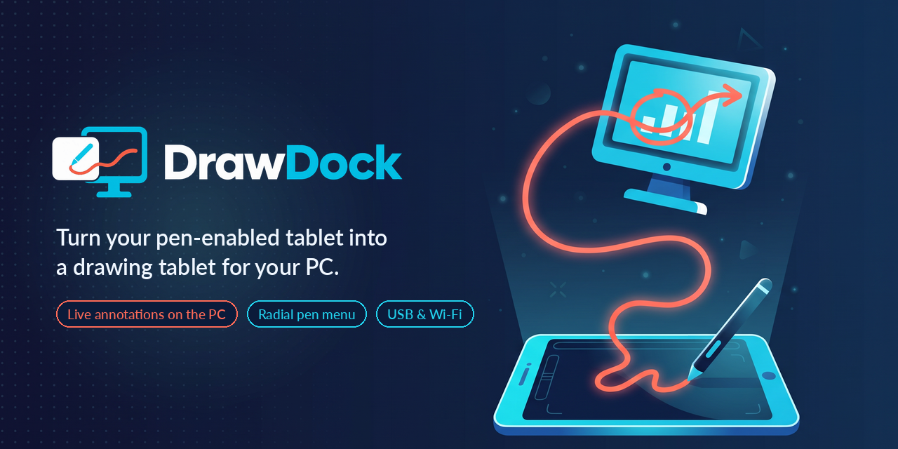

# DrawDock

DrawDock turns an Android tablet and pen into a drawing and presentation
companion for Windows. A native Rust host renders annotations over applications
on the selected PC monitor or projector. A Kotlin Android client mirrors that
display and sends pen input over authenticated TLS/TCP.

The drawing workspace includes a pen-long-press radial menu, freehand and
geometric shapes, text, image paste from the tablet clipboard, single-object
transformations, a laser pointer, highlighter, blackboard and grid. Pointer mode
lets the pen control the Windows mouse.
Shared 100-400% desktop/annotation zoom supports two-finger pinch/pan and menu
controls on both the selected PC output and tablet.

The desktop application runs natively on Windows, without WSL, Linux or Docker.
USB uses an explicit ADB reverse mapping; private-network connections use an
explicitly selected IP address. First pairing uses a QR invitation and local
PC approval; remembered devices reconnect with certificate pinning.
The native Windows launcher provides a taskbar window, tray icon, independent
USB/private-LAN listener controls and live logs. The direct CLI remains available.

## Getting started

1. Follow the [development setup](docs/development.md) to build the host and APK.
2. [Start the Windows host](docs/run-windows.md) and
   [install/connect the Android app](docs/run-android-and-adb.md).
3. Hold the pen still on the mirrored image to open the drawing menu.

## Documentation

| Guide | Contents |
|---|---|
| [Documentation index](docs/README.md) | Contributor documentation map |
| [Architecture](docs/architecture.md) | Components, data flow and lifecycle |
| [Features and interaction](docs/features.md) | Drawing, editing and presentation behavior |
| [Brand and UI guidelines](docs/branding.md) | Assets, design references and interaction-preserving styling |
| [Protocol](docs/protocol.md) | Wire format, commands, responses and limits |
| [Pairing and security](docs/pairing-and-threat-model.md) | Authentication, storage and trust boundaries |
| [Video streaming](docs/video-streaming.md) | Capture, encoding, decoding and ink handoff |

Original design inputs live in [specs](specs/).
Milestones, environment snapshots and validation/feasibility records live
separately in [project-status](project-status/README.md).
