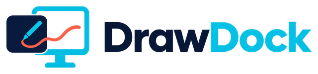
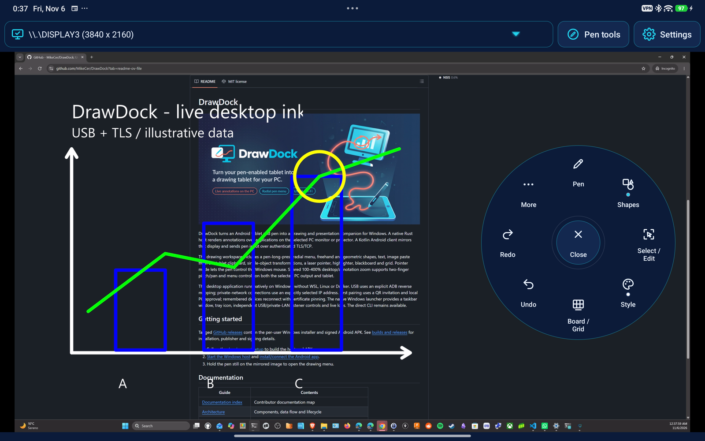
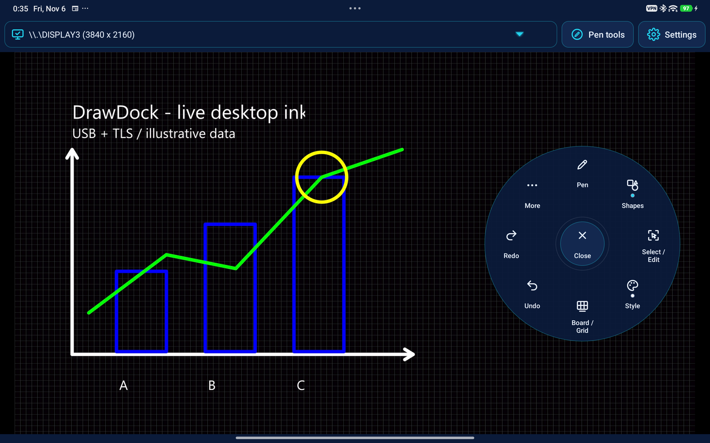
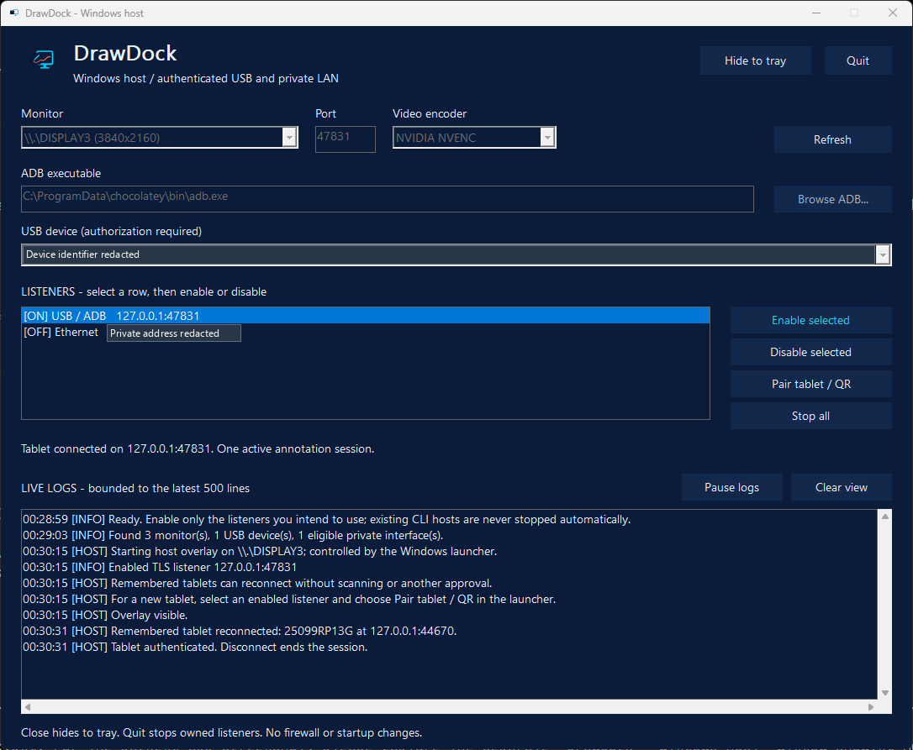
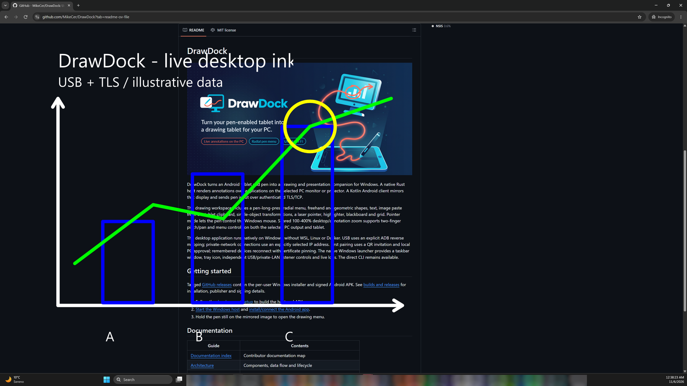
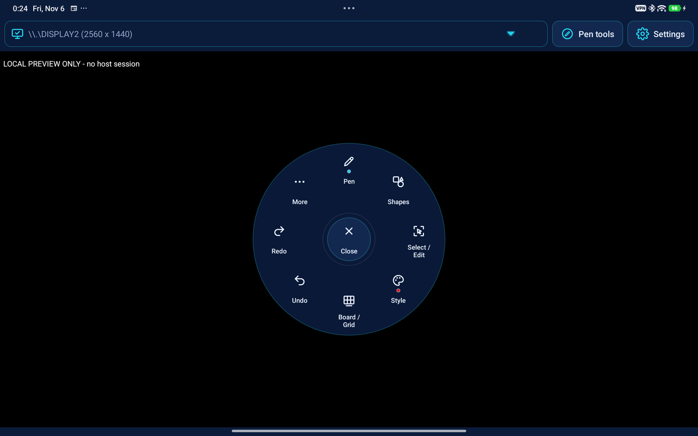
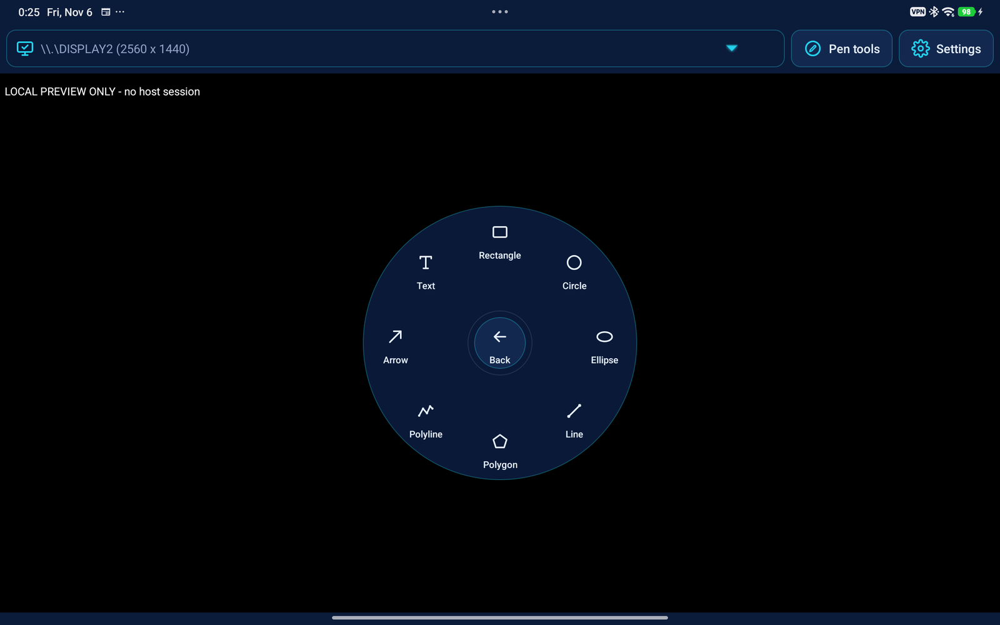

<p align="center">
  <picture>
    <source media="(prefers-color-scheme: dark)" srcset="docs/assets/brand/logo-dark.png">
    
  </picture>
</p>

<h1 align="center">DrawDock</h1>

<p align="center">
  Turn your Android tablet and pen into a live annotation and presentation companion for Windows.
</p>

<p align="center">
  <a href="#supported-devices-operating-systems-and-connections"></a>
  <a href="#supported-devices-operating-systems-and-connections"></a>
  <a href="#architecture"></a>
  <a href="LICENSE"></a>
</p>

<p align="center">
  <a href="https://github.com/MikeCer/DrawDock/releases"><b>Downloads</b></a>
  &bull; <a href="#installation-and-first-connection">Quick start</a>
  &bull; <a href="#screenshots">Screenshots</a>
  &bull; <a href="docs/README.md">Documentation</a>
</p>

Write over live applications on the **physical PC monitor or projector**, while
seeing the same display on your tablet. Switch between annotations and mouse
control without importing slides or editing the underlying document.
The host runs natively on Windows: no WSL, Linux VM or Docker required.

> [!IMPORTANT]
> **Early-stage, Windows-first proof of concept.** Features are implemented, but
> this is not a universal device-compatibility or fullscreen-support guarantee.
> Validate your pen, display and presentation application before a live session.

**On this page:** [What works](#what-works-today) |
[Compatibility](#supported-devices-operating-systems-and-connections) |
[Limitations](#known-limitations) | [Troubleshooting](#troubleshooting) |
[Architecture](#architecture) | [Roadmap](#roadmap) |
[Contributing](#contributing) | [Documentation index](#documentation) |
[License](#license)

<a id="screenshots"></a>

## 🖼️ Screenshots

Real captures of the connected Android app and Windows host, not design mockups.
The tablet mirrors Chrome running on Windows, with the same annotations visible
on the PC display. The connected session uses USB/ADB and authenticated TLS.
Tablet captures are full-screen ADB screenshots, downscaled without cropping;
Windows captures were supplied from the same session.

The chart uses illustrative data and automated stylus events through the real
app's drawing tools. These stills are **not an end-to-end video or proof of
physical pen/fullscreen behavior**.

<p align="center">
  
  <br>
  <sub>Draw over a real Windows browser while viewing and controlling the annotations from the tablet.</sub>
</p>

<table>
  <tr>
    <td width="50%" align="center">
      <a href="docs/assets/screenshots/tablet-connected-chart.png"></a>
      <br>
      <b>Blackboard, grid and drawing tools</b><br>
      <sub>A live host scene with an illustrative chart. Click to enlarge.</sub>
    </td>
    <td width="50%" align="center">
      <a href="docs/assets/screenshots/windows-host.png"></a>
      <br>
      <b>Native Windows host</b><br>
      <sub>USB connected, private LAN disabled, live logs visible. Device identifier and private address redacted. Click to enlarge.</sub>
    </td>
  </tr>
</table>

<details>
<summary><b>More captures: the Windows display and tablet tool menus</b></summary>

<p align="center">
  
  <br>
  <sub>The PC side of the session: the annotations are over Chrome on Windows, not confined to the tablet.</sub>
</p>

<p align="center">
  
  <br>
  <sub>A separate, disconnected preview of the radial pen menu.</sub>
</p>

<p align="center">
  
  <br>
  <sub>Shapes and text tools in the full-screen tablet app, shown disconnected.</sub>
</p>

</details>

<a id="download--quick-start"></a>

## 📦 Download / Quick start

Get matching Windows and Android packages from
**[GitHub Releases](https://github.com/MikeCer/DrawDock/releases)**.
Packages are published by release tags; if no release is listed yet,
[build from source](docs/development.md).

| Download | Use |
|---|---|
| `DrawDock-<version>-windows-x64-setup.exe` | Recommended per-user Windows installation |
| `DrawDock-<version>-windows-x64-portable.zip` | Extract and run `drawdock-launcher.exe`; keep the bundled files together |
| `DrawDock-<version>-android.apk` | Android tablet client, signed with the project's release key |

Windows packages include **ADB and FFmpeg**; a separate Android SDK is not
required for normal packaged-host use. Verify downloads against `SHA256SUMS.txt`.
The matching third-party source archive is included with each release.

> [!CAUTION]
> Windows binaries are currently **not Authenticode-signed**. Their publisher
> metadata is **Mike Cerreto**, not a verified signing identity. Do not bypass
> operating-system security warnings. See [release and signing details](docs/releasing.md).

Already have both apps? Go directly to [first connection](#installation-and-first-connection).

<a id="installation-and-first-connection"></a>

## 🚀 Installation and first connection

**Start with USB:** install → connect → start the host → pair → draw.

**Have ready:** a Windows 11 x64 PC, an Android 11+ tablet with a compatible
active pen, and a **USB data cable** (not a charging-only cable).
See [compatibility](#supported-devices-operating-systems-and-connections) for
hardware and OS boundaries.

### 1. Install on both devices

Download the Windows installer and Android APK from the **same
[release](https://github.com/MikeCer/DrawDock/releases)**.

| Where | What to do |
|---|---|
| **Windows PC** | Run `DrawDock-<version>-windows-x64-setup.exe`, then open **DrawDock** |
| **Android tablet** | Open `DrawDock-<version>-android.apk` on the tablet, follow Android's installation prompts, then open **DrawDock** |

**Ready to continue:** DrawDock is open on both devices.
The Windows installer is per-user; it does not install USB drivers, change
firewall rules or request elevation. The unsigned-Windows warning above still
applies.

Building from source instead? Follow [Development](docs/development.md) and
[Android installation](docs/run-android-and-adb.md#build-and-install).

### 2. Connect and authorize USB

1. **On the tablet:** enable **USB debugging** in Android's **Developer options**.
   The steps to reveal Developer options vary by manufacturer.
2. **Connect the tablet to the PC** with the USB data cable.
3. **On the tablet:** accept the USB debugging authorization prompt only if it
   identifies the PC you intend to use.

**Ready to continue:** in the Windows host, click **Refresh** and find your
authorized tablet in the **USB device** dropdown.
If it is missing or unauthorized, start with [USB troubleshooting](#troubleshooting);
some tablets need an OEM Windows USB driver.

### 3. Start the Windows host

In the **Windows DrawDock window**:

1. Set **Monitor** to the PC screen or projector you want to annotate.
2. Set **Video encoder** to **Software (x264)** or to **NVIDIA NVENC** if you have NVIDA GPU for the first connection.
3. Select your authorized tablet under **USB device**.
4. Select the **USB / ADB** listener row, then click **Enable selected**.
   Leave the private LAN listener off for this first USB test.

**Ready to continue:** the USB listener is marked **[ON]**.

### 4. Pair the tablet with this PC

| Order | Where | What to do |
|---|---|---|
| 1 | **Windows PC** | Keep the enabled USB listener selected and click **Pair tablet / QR** |
| 2 | **Android tablet** | In DrawDock, choose **Connect > Scan QR**, allow camera access if desired, scan the PC's invitation and confirm the endpoint |
| 3 | **Windows PC** | Approve the tablet in the native pairing dialog |

No camera? Use the Android app's manual invitation entry instead.
See [pairing instructions](docs/run-android-and-adb.md#pair-and-reconnect).

**Ready to continue:** the host reports a connected tablet and the selected
Windows display appears in the tablet workspace. Wait until the video is ready.

### 5. Try your first annotation

Open a browser, document or presentation on the **selected Windows display**.
On the tablet, choose **Pen tools > Pen** and draw inside the mirrored image.
Use **Pen tools** to try shapes, colors or the laser pointer.

> [!TIP]
> **Success means the same marks appear on both the tablet and the physical PC
> monitor/projector.** Marks visible only on the tablet are not a successful
> end-to-end test.

Completed objects and Blackboard/Grid settings are saved privately on the
tablet before transmission. If USB or Wi-Fi drops, the saved drawing stays
visible with editing paused; DrawDock retries the same authenticated endpoint
and restores it to its original monitor. Backgrounding pauses retries until
you return. **Disconnect / Stop retrying** retains the drawing and stops retries;
after restarting the app, tap **Connect** to recover it.

| After the first test | What to do |
|---|---|
| **Connect again** | With the same Windows USB listener enabled, tap **Connect** on the tablet; a remembered device does not need another QR scan or approval |
| **Finish** | Choose **Stop all** to stop listeners, or **Quit** to exit the Windows host. Closing its window with **X** only hides it to the tray |

<details>
<summary><b>Prefer Wi-Fi? Set up a private LAN connection</b></summary>

For Wi-Fi, enable the chosen private LAN endpoint instead of USB.
Use **Pair another PC** to enroll that endpoint; the app stores one endpoint
and does not automatically switch between USB and LAN.
Follow the [private-network guide](docs/run-windows.md#private-network-connections)
for routing and explicitly approved, scoped firewall configuration.

</details>

<a id="what-works-today"></a>

## ✨ What works today

| Capability | Available behavior |
|---|---|
| **Live desktop annotations** | Pen input produces a host overlay over the selected Windows output; the tablet mirrors it |
| **Drawing and content** | Freehand, highlighter, lines, arrows, rectangles, ellipses, circles, polygons, polylines, text and tablet clipboard images |
| **Object editing** | Single-object selection, move, rotate, resize, mirror, undo/redo and an undoable Clear |
| **Presentation tools** | Temporary laser pointer, blackboard and grid |
| **Shared navigation** | 100-400% zoom and pan on both PC and tablet, using two fingers or menu controls |
| **Pointer mode** | Stylus mouse movement, click, drag and barrel-button right-click where the pen supports it |
| **Monitor selection** | Select and switch existing PC outputs with aspect-preserving video and coordinate mapping |
| **Pairing and reconnect** | QR or manual invitation, native PC approval, certificate pinning and remembered devices |
| **Windows launcher** | Native taskbar/tray UI, explicit listener controls and a live log viewer; CLI also available |

Hold the pen still for about **550 ms**, then lift to open the radial menu.
The **Pen tools** button is an alternative. Fingers do not draw; two fingers
navigate the shared view. Read the [full interaction guide](docs/features.md).

<a id="supported-devices-operating-systems-and-connections"></a>

## 💻 Supported devices, operating systems and connections

| Component | Current requirements and boundaries |
|---|---|
| **Windows host** | Windows 11 x64 is the primary target. The installer accepts Windows 10+, but that is not a Windows 10 validation claim |
| **Android client** | Android 11 / API 30 or later, a compatible active stylus and an H.264 decoder supporting the negotiated stream |
| **Pen** | Must be reported as a stylus by Android; hover and barrel-button capabilities depend on hardware |
| **Displays** | An existing Windows monitor or projector; no virtual monitor is created |
| **GPU** | Software encoding is available; optional NVENC requires a compatible NVIDIA GPU, driver and encoder |
| **Other platforms** | No iPadOS, macOS or Linux client/host implementation is currently provided |

Minimum OS versions are not a certified tablet list. Manufacturer-specific
stylus behavior, decoder support, DPI and fullscreen modes still need validation
on the intended setup.

| Connection | Setup |
|---|---|
| **USB / ADB** | USB data cable, tablet USB debugging and explicit PC authorization; some devices need an OEM Windows USB driver |
| **Wi-Fi / private LAN** | Tablet and PC on a trusted LAN; choose an assigned private IPv4 address on a Private/domain Windows network profile |
| **Ethernet + Wi-Fi** | The PC may be wired while the tablet uses Wi-Fi on the same LAN; this is the same TLS/TCP connection, not a separate protocol |

Control and video use **authenticated TLS/TCP**, including over USB.
No cloud account, public listener or wireless ADB is required.
Linux adapters and QUIC remain **deferred**.

<a id="known-limitations"></a>

## ⚠️ Known limitations

| Area | Important boundary |
|---|---|
| **Drawing recovery** | Update both apps for recovery support. Completed objects survive connection/app/host restarts, but restored undo/redo history, laser, selection and zoom do not. Unfinished contacts are cancelled. No export yet; uninstalling Android or clearing its app data removes saved drawings |
| **Concurrency** | One active tablet session; Android remembers one PC endpoint rather than a multi-host/transport list |
| **Desktop restrictions** | Secure desktop, UAC, protected content and exclusive fullscreen paths are not bypassed; elevated apps cannot be controlled by automatic elevation |
| **Input and editing** | Uniform stroke widths, not pressure-sensitive rendering; no eraser, per-object deletion or multi-object selection |
| **Latency and video** | Zoom pauses input until matching video is ready; capture/decoder delay varies, and translucent highlighter can briefly show extra opacity |
| **Recovery** | Video failure requires reconnecting; there is no automatic video recovery or adaptive bitrate |
| **Zoom and PC mouse** | Shared zoom does not remap the physical PC mouse; reset to 100% before using it to click desktop controls |

Release and debug APKs use different signing identities. Read the
[signing and upgrade guidance](docs/releasing.md#android-signing-and-backup)
before switching; uninstalling the debug app removes its data.
Build/test success and tablet screenshots do not replace real pen,
physical-monitor, projector and fullscreen acceptance checks.

<a id="troubleshooting"></a>

## 🛠️ Troubleshooting

| Symptom | Start here |
|---|---|
| USB tablet is missing or unauthorized | Check the data cable, USB debugging, tablet authorization prompt and selected device; verify with `adb devices -l` |
| Connect fails over USB | Verify that the USB listener is enabled and its ADB reverse mapping uses the same port |
| LAN connection times out | Check the chosen IP, Private/domain profile, routing, Wi-Fi client isolation and scoped firewall policy |
| Connect still uses the old USB/LAN address | Choose **Pair another PC** and pair the intended endpoint |
| Video fails or input stays suspended | Try software encoding, inspect host logs and reconnect; verify the tablet decoder supports the negotiated stream |
| Pen hold does not open tools | Hold the stylus still inside the mirrored image, or use **Pen tools**; finger holds do not open the menu |
| The host window disappears after X | It is hidden to the tray; click the tray icon or launch DrawDock again |
| Certificate pin or trust-store error | Verify the intended PC identity and file permissions; do not disable certificate validation or silently reset trust |

More detail: [Android troubleshooting](docs/run-android-and-adb.md#troubleshooting)
and [Windows video/host troubleshooting](docs/run-windows.md#video-configuration-and-troubleshooting).
The Windows launcher's log viewer is the first place to inspect connection and
encoder errors. Do not publish pairing tokens, credentials or sensitive desktop captures.

<a id="architecture"></a>

## 🧩 Architecture

DrawDock separates **pen input**, **host-owned scene state** and **desktop video**.
The tablet sends commands; Windows renders the authoritative overlay on the
physical output, then streams that output back to the tablet.

| Component | Technology | Responsibility |
|---|---|---|
| Android client | Kotlin, native Views/Canvas, MediaCodec | Stylus input, radial tools, provisional ink, H.264 decoding and pinned TLS |
| Windows host | Rust, Win32, software rasterization, FFmpeg | Click-through overlay, mouse injection, capture/encoding, pairing and listener management |
| Shared scene core | Rust `dd-scene` | Validated geometry, object transforms, canvas state and bounded undo/redo |
| Wire contract | Versioned JSON + H.264 over TLS/TCP | Separate authenticated control/video connections, source epochs and readiness barriers |

Application logic stays native; FFmpeg is an owned subprocess, not a desktop
runtime container. Learn more in [Architecture](docs/architecture.md),
[Protocol](docs/protocol.md) and [Video streaming](docs/video-streaming.md).

<a id="roadmap"></a>

## 🗺️ Roadmap

Priorities, not delivery commitments:

| Horizon | Focus |
|---|---|
| **Release readiness** | First tagged release, broader physical pen/fullscreen/projector validation and a recorded PC-plus-tablet demo |
| **Usability and performance** | More device coverage, smoother shared zoom, translucent-ink handoff and recovery under real network conditions |
| **Distribution** | Evaluate trusted Windows code signing and improve contributor/release documentation |
| **Deferred** | Linux X11/Wayland/GNOME adapters and QUIC evaluation; no support claim or implementation schedule |

Use [issues](https://github.com/MikeCer/DrawDock/issues) to report reproducible
problems or discuss changes before expanding scope.

<a id="contributing"></a>

## 🤝 Contributing

Start with [Development](docs/development.md) and
[Architecture](docs/architecture.md). Keep Rust unit tests in the existing
`tests\unit` folders and Android tests in `src\test`.
Protocol and coordinate changes usually require matching Rust and Kotlin updates.

Run the relevant checks locally after configuring the documented prerequisites:

```powershell
cargo fmt --all -- --check
cargo test --workspace
cargo clippy --workspace --all-targets -- -D warnings
gradle -p .\android testDebugUnitTest assembleDebug lintDebug
```

GitHub Actions builds, tests and publishes **only on pushed release tags**
(`vMAJOR.MINOR.PATCH`), not on ordinary commits or pull requests.
See [Builds and releases](docs/releasing.md) before tagging.

For bug reports, include OS/API versions, pen/device capabilities, transport,
encoder, reproduction steps and sanitized logs. Distinguish automated/injected
input from physical pen tests, and mark unavailable hardware checks as NOT RUN.

<a id="documentation"></a>

## 📚 Documentation

The **[documentation index](docs/README.md)** is the entry point for the
implementation guides.

| Guide | What you will find |
|---|---|
| [Development](docs/development.md) | Toolchains, source builds, tests and contribution checks |
| [Windows host](docs/run-windows.md) | Launcher, CLI, displays, listeners, logs and device administration |
| [Android and ADB](docs/run-android-and-adb.md) | Installation, USB forwarding, pairing, reconnect and troubleshooting |
| [Features and interaction](docs/features.md) | Drawing tools, radial menus, transforms and presentation gestures |
| [Architecture](docs/architecture.md) | Components, data flow, threading and lifecycle |
| [Protocol](docs/protocol.md) | Messages, video framing, geometry epochs and resource limits |
| [Pairing and threat model](docs/pairing-and-threat-model.md) | Trust, credentials, permissions and security boundaries |
| [Video streaming](docs/video-streaming.md) | Capture, codecs, backpressure and provisional-ink handoff |
| [Brand and UI guidelines](docs/branding.md) | Component-owned assets, visual tokens and interaction-preserving styling |
| [Builds and releases](docs/releasing.md) | Tagged builds, Windows packaging, signing and third-party sources |

[Implementation-aligned specifications](specs/) also describe deferred design beyond the current
executable contract; use the guides above for implemented behavior.

<a id="license"></a>

## ⚖️ License

DrawDock is available under the **[MIT License](LICENSE)**.
Bundled FFmpeg/x264 components have separate **GPLv2-or-later** terms; their
notices and matching source archives accompany Windows releases.
See [runtime licensing and distribution](docs/releasing.md#windows-installation-and-runtime).
