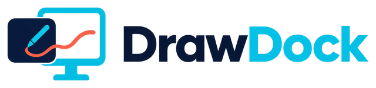

<picture>
  <source media="(prefers-color-scheme: dark)" srcset="assets/brand/logo-dark.png">
  
</picture>

# Contributor documentation

These guides describe how DrawDock works and how to build, change and test it.

| Document | Purpose |
|---|---|
| [Architecture](architecture.md) | Component ownership, threading, geometry and session lifecycle |
| [Features](features.md) | Drawing tools, radial menu, editing and presentation semantics |
| [Brand and UI guidelines](branding.md) | Asset ownership, documentation imagery, UI styling and compatibility rules |
| [Development](development.md) | Prerequisites, repository layout, build/test commands and contribution workflow |
| [Builds and releases](releasing.md) | Tagged releases, per-user Windows installer, runtime licenses and APK signing |
| [Windows host](run-windows.md) | CLI, launcher, displays, transport and device administration |
| [Android and ADB](run-android-and-adb.md) | Build, install, pair, connect and troubleshoot |
| [Protocol](protocol.md) | Control JSON, transactions, response shapes and video framing |
| [Pairing and threat model](pairing-and-threat-model.md) | Trust establishment, credential protection and security boundaries |
| [Video streaming](video-streaming.md) | FFmpeg pipeline, encoder settings, MediaCodec and backpressure |

Start with Architecture and Development before changing either application.
Changes to messages, coordinate handling or scene state usually require matching
Rust and Kotlin updates. Keep the protocol and feature guides aligned with code.
