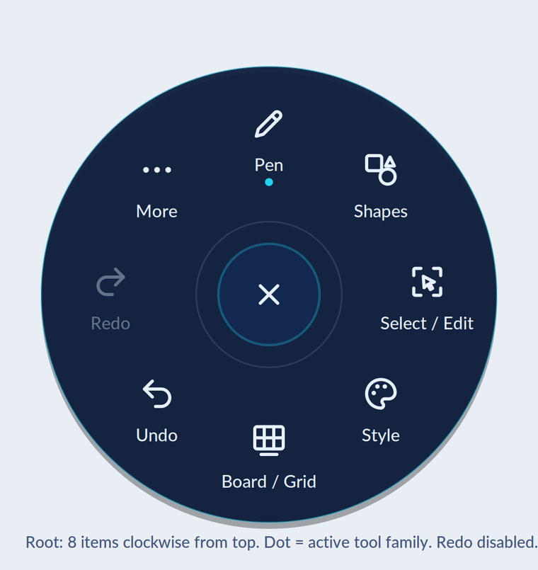
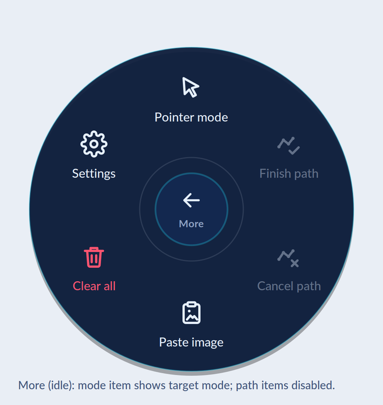
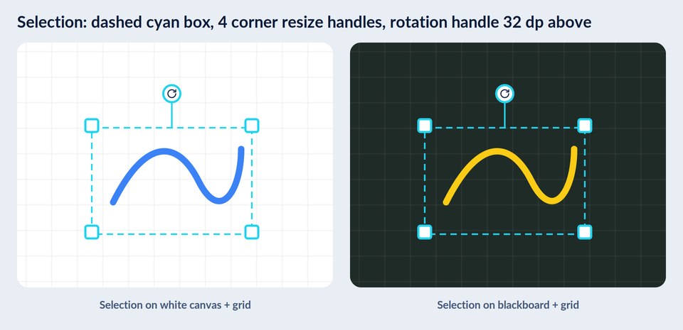

# Brand and UI guidelines

DrawDock uses deep navy surfaces, cyan interaction accents, coral brand artwork
and light text/icons on dark surfaces. Branding is a visual layer over the
existing [feature contract](features.md); it must not change annotation,
transport, trust or input behavior.

The visual palette is navy `#0B1B3A`, cyan `#22D3EE`, coral `#FF6B57`,
light text `#E6F0FF` and danger `#FF5470`. These are RGB values, separate
from the annotation palette below.

## Asset ownership and destinations

Each component owns the graphics and styling sources it uses. Documentation
images are checked in under `docs/assets/brand`; Android graphics and tokens
belong in its own resource tree when integrated. A fresh clone must render,
build and run without regenerating design assets.

The optional Copilot [branding skill](../.github/skills/drawdock-brand-ui/SKILL.md)
owns design references, master assets and generators under
`.github/skills/drawdock-brand-ui`. Application resources remain component-owned;
neither app loads skill assets at runtime. This guide's compatibility rules
override conflicting skill samples.

| Surface | Asset and treatment |
|---|---|
| Root README | `docs/assets/brand/github-cover.png`; keep the introduction and setup links as real text |
| GitHub social preview | Reuse `docs/assets/brand/github-cover.png`, 1280x640; configure separately in repository settings |
| Documentation index | `logo-light.png` / `logo-dark.png`, displayed at 320 pixels using a theme-aware `picture` |
| Technical documentation | Selected, clearly labeled design references; no decorative banner on every page |
| Android radial menu | Component-owned `ic_dd_*.xml` drawables and typed Views resources under `android/app/src/main/res` |
| Android header/settings | Pen tools, monitor, mode and connection/transport icons with accessible text |
| Launcher/system splash | Adaptive launcher assets and splash icon, integrated separately from menu styling |
| Optional onboarding | At most a small selection of optimized illustrations, without delaying drawing or reconnect |
| Windows host launcher | Embedded component-owned `apps/dd-host/assets/drawdock.ico`; native navy/cyan Win32 controls and labeled actions, without recoloring the captured desktop or changing approval |

Use original artwork without stretching, recoloring logos or removing their
transparent background. Keep dark and light logo variants paired. Use text
labels alongside unfamiliar icons, and never rely on color alone for meaning.

The host ICO contains 16-256 px versions derived from the approved
Android-owned launcher artwork. It is embedded at build time for the window,
taskbar and tray; neither application reads the design kit at runtime.
Launcher controls retain native keyboard/accessibility semantics, text
ON/OFF listener labels and focus feedback. Executable icon/version resources and
installer shortcuts are described in [builds and releases](releasing.md).

Android eight-digit colors use ARGB (`#AARRGGBB`). Convert explicitly for SVG/CSS;
an eight-digit CSS color uses a different channel order. Standalone SVG icon
exports need explicit colors: Markdown image embedding does not reliably
inherit the surrounding page's `currentColor`.

## Radial menu design references

**Design references, not application screenshots.** These images illustrate
the intended visual language. They do not prove an implemented UI state, and
the compatibility rules below override their selection sizes, ink colors and
disabled-state examples.



The root order stays Pen, Shapes, Select / Edit, Style, Board / Grid, Undo,
Redo, More, clockwise from the top. Center Close/Back and the existing action
versus submenu dismissal behavior remain unchanged.



Use semantic action icons with labels matching the [menu inventory](features.md).
Color uses swatches; width uses a live line preview or matching width icons.
The More mode icon represents the mode to switch to,
not the current mode. Clear all uses danger styling without changing its scope
or confirmation.

## Approved compatibility rules

| Area | Required treatment |
|---|---|
| Input and menu | Preserve stationary stylus hold timing/slop, deferred pointer-down, finger exclusion, item order, action dismissal and readiness gating |
| Selection | Keep the 4 dp solid border, 7 dp white contrast underlay, 28 dp visible handles, 48 dp hit targets and 48 dp rotation offset; brand colors/icons may change |
| Transform geometry | Preserve oriented corners, opposite resize anchors, mirrored/sheared transforms, viewport clamping and acknowledgement handling |
| Ink colors | Keep the application palette below; brand colors do not redefine annotation colors |
| Widths | Preserve Thin 3 dp, Medium 6 dp and Thick 12 dp, including their existing text-size mapping |
| Blackboard/Grid | Keep host-authoritative black fill and 32-physical-pixel grid; do not paint a different local tablet background over video |
| Highlighter/Laser | Preserve the current alpha, cap, selected-color and refresh/expiry behavior; do not add a fading trail as a styling side effect |
| Polygon/polyline | Preview improvements must not introduce tap-first-vertex completion; Finish/Cancel path semantics stay unchanged |
| Availability | Reflect known application state only; do not infer host Undo/Redo availability from the local preview |
| Feature scope | No eraser, per-object deletion, arbitrary color picker or opacity slider |
| Layout/accessibility | Preserve usable targets and readable labels at large font sizes and viewport edges; do not blindly shrink the disc or clip long labels |
| Animation | Respect system animation settings; animation must not delay input cancellation, source changes or a queued action |

The annotation palette, in menu order, is Red `#FF0000`, Orange `#FF9800`,
Yellow `#FFFF00`, Green `#00FF00`, Blue `#0000FF`, Black `#000000`,
White `#FFFFFF`. These are RGB values; highlighter alpha is applied separately.



This selection reference illustrates contrast, not the approved dimensions.
Do not copy its 1.5 dp dashed perimeter, 40 dp hit targets, reduced handles,
green-black background or grid spacing into the application.

## Android radial menu implementation

`RadialMenuView` keeps native accessible `Button` children, with vector icons,
labels, pressed/hover/focus feedback and an icon-backed Close/Back button.
`MainActivity` maps every action to its icon and supplies current application
state. The selected tool has a cyan disc; selected swatches have a ring and
check mark. Width previews use the actual 3/6/12 dp width and current ink color.
The root indicates the active tool family and current color.

Blackboard/Grid use acknowledged host state for cyan styling, an ON badge and
an accessibility state description. Their labels still describe the action
(ON to enable, OFF to disable). More shows the target Draw/Pointer mode, and
Clear all uses danger styling while retaining its confirmation dialog.
Visible pages refresh after editor acknowledgements. Undo/Redo and path actions
remain available with their existing validation; there are no guessed
disabled states.

The preferred disc remains 350 dp, not the smaller design-reference disc.
Buttons are at least 66 dp and expand to fit scaled text. Geometry reserves
space for nonoverlapping square targets and an 8 dp workspace margin, shifting
the anchor away from edges. If the full menu cannot fit, a scrollable list
keeps the same item order/actions and Close/Back without shrinking labels or
targets. Transitions remain immediate, including with system animations
disabled; no animation can delay input cancellation or a queued action.

The Android-owned sources are:

| Source | Responsibility |
|---|---|
| `android/app/src/main/res/drawable/ic_dd_*.xml` | Menu vector sources, tinted at use sites and cached per menu page |
| `android/app/src/main/res/values/dd_menu_colors.xml` | Menu surfaces, text, state accents and danger styling |
| `android/app/src/main/res/values/dd_menu_dimens.xml` | Menu dimensions, scaled label sizes and width previews |
| `RadialMenuGeometry.kt` / `RadialMenuGeometryTest.kt` | Edge placement, nonoverlapping targets and small-window fallback decisions |

Edit these sources directly. They are not generated from the skill templates.
No new runtime dependency, Compose migration or external graphics path is
required. Annotation palette, host scene rendering, selection handles and
canvas gesture handling remain independent of menu styling.

More also contains Zoom, with a labeled Zoom in / Zoom out / Reset submenu.
Its `ic_dd_zoom_in`, `ic_dd_zoom_out` and `ic_dd_zoom_reset` vectors are
component-owned additions: the supplied kit contains no zoom artwork.
They follow the existing white 24 px, 2 px-outline icon vocabulary and receive
the same tint, label, focus feedback and scalable targets as other actions.
The Zoom entry reports the acknowledged percentage in its accessible
description; the icon alone is not the state indicator. See
[shared zoom and pan](features.md#shared-zoom-and-pan) for functional behavior.

## App chrome and dialogs

`Theme.DrawDock` is a native Views theme with the same navy surfaces, cyan
accents and light text as the menu. It does not require AppCompat, Compose or
Material Components. System-bar foreground colors follow the dark app surface;
the captured desktop and native Windows overlay are not recolored.

The header uses labeled Pen tools and Settings buttons plus a monitor dropdown.
The selector's adapter keeps the original source list and selection callbacks,
with component-owned selected-row/popup layouts. Its disabled text and native
enabled state reflect the existing source-readiness barrier. The dropdown
uses the platform arrow tinted cyan rather than an invented brand icon.

The connection panel uses a raised rounded surface, primary Connect/Disconnect
button and outlined pairing/forget actions. Buttons retain at least 48 dp
targets, scaled labels and pressed/hover/keyboard-focus feedback. Settings
remains scrollable and does not reserve permanent canvas space. Connection
icons follow the existing connection state; no transport/authentication behavior
is inferred from styling.

`Theme.DrawDock.Dialog` and `showBranded` style the pairing chooser, manual
invitation, scanned-PC confirmation, text entry, Forget and Clear dialogs.
Positive actions use cyan; destructive confirmations keep danger-colored
text and their existing confirmation/cancellation handlers. Manual invitation
fields have persistent labels and accessible descriptions; fields and long
content remain scrollable. Camera permission and other operating-system dialogs
remain system-controlled.

Additional Android-owned sources:

| Source | Responsibility |
|---|---|
| `values/dd_ui_colors.xml`, `dd_ui_dimens.xml`, `dd_ui_styles.xml` | Shared chrome/dialog tokens and native widget themes |
| `color/dd_ui_control_text.xml` | Enabled/disabled control text |
| `drawable/dd_button*_background.xml`, `dd_field_background.xml`, `dd_panel_background.xml` | Rounded surfaces and interaction states |
| `layout/dd_spinner_selected.xml`, `dd_spinner_option.xml` | Monitor selector and popup rows |
| `drawable/ic_dd_pen_tools.xml`, `ic_dd_monitor_select.xml`, `ic_dd_connected.xml`, `ic_dd_disconnected.xml` | Four header/connection vectors in addition to the 38 menu vectors |

These paths are relative to `android/app/src/main/res`. The app manifest selects
the native theme. Pair/Forget retain readable text labels because the supplied
icon map has no dedicated icons for those actions. Launcher/splash artwork is
independent of this control styling.

## Launcher icon and system splash

The application declares `ic_dd_launcher` for both its regular and round icon.
Its adaptive layers use the original transparent foreground on the supplied
light `#F0F7FF` background. The foreground wrapper adds an 8% inset on each
edge, uniformly scaling the artwork into Android's 66 dp safe circle inside
the 108 dp layer. This prevents circular masks from clipping the monitor.
It does not stretch, crop or recolor the PNGs.

The minimum Android version is API 30, so legacy pre-adaptive launcher bitmaps
are not bundled. A monochrome themed icon is not declared: it needs a dedicated
silhouette rather than the opaque tablet panel from the multicolor foreground.

Only `MainActivity` uses `Theme.DrawDock.Starting`. AndroidX
`core-splashscreen` supplies the API 30 compatibility implementation and delegates
to the native system splash on API 31+. `installSplashScreen()` runs before
`super.onCreate()` and applies `Theme.DrawDock` through `postSplashScreenTheme`
before the normal Views are constructed. Other activities retain the application
theme, including the QR scanner.

The splash uses a navy background and the supplied transparent, static icon.
The xxxhdpi PNG is 1152x1152 pixels, corresponding to the 288 dp icon canvas;
its artwork fits the central 192 dp safe circle. API 33+ requests
`icon_preferred` so the system does not substitute a plain-color launch window.
There is no custom splash activity, retention condition, timer, added animation
or illustrated onboarding. Network connection and video readiness do not hold
the splash; normal intent handling and remembered pairing remain independent.
Returning to an already-created activity uses the normal system resume path.

All launch graphics are Android-owned:

| Source under `android/app/src/main/res` | Responsibility |
|---|---|
| `mipmap-anydpi-v26/ic_dd_launcher.xml` | Adaptive icon shared by regular and round launcher declarations |
| `mipmap-{mdpi,hdpi,xhdpi,xxhdpi,xxxhdpi}/ic_dd_launcher_artwork.png` | Five original foreground density variants |
| `drawable/ic_dd_launcher_foreground.xml` | Uniform safe-zone inset without modifying source pixels |
| `drawable-xxxhdpi/dd_splash_icon.png` | Static transparent splash artwork |
| `values/dd_launch.xml` | Launcher background, shared starting theme and app-theme handoff |
| `values-v33/dd_launch.xml` | Android 13+ native icon-preference attribute |

Edit these component-owned resources directly; no export step or design kit
is needed. Keep adaptive and splash safe zones when replacing artwork, and
verify an actual cold launch, warm activity creation and hot resume in addition
to building the APK.

## Android integration boundaries

Use the existing Kotlin Views/custom Canvas implementation; a Compose migration
is not required. Keep actionable items accessible instead of replacing them
with an unlabeled bitmap. Cache tinted drawables outside drawing callbacks.
Keep `dd_` / `ic_dd_` resource prefixes and avoid collisions with existing names.

Copy only the required icons into the Android component and define its colors,
dimensions and motion values in typed Views resources. Alpha and animation
scales also need typed scalar resources, not hardcoded UI literals. Reconcile
the compatibility rules before importing values. If generated resources are
introduced, their generator and inputs must be checked in with that component;
update sources and outputs together without adding a build-time skill dependency.

The host does not currently send authoritative `canUndo`/`canRedo` state. Keep
existing actions usable rather than presenting guessed disabled states. Adding
host availability metadata would be a separate behavior/protocol change.

Launcher/splash graphics need the actual app theme and API 30-compatible
integration. Do not copy a template resource tree wholesale. Do not bundle
mockups, unused illustrations, Compose samples or documentation exports into
the APK.

## Maintaining documentation assets

The six checked-in PNGs are the documentation's usable source assets, not
outputs that contributors must regenerate before viewing the guides. No Python,
Pillow or original kit is needed to render them.

When replacing an image, preserve its aspect ratio and transparency, optimize
the PNG, and review it at the displayed size. Keep these maximum widths:

| Image | Maximum width |
|---|---|
| `github-cover.png` | 1280 px (1280x640 for GitHub social preview) |
| `logo-light.png`, `logo-dark.png` | 640 px |
| `radial-menu-root.png`, `radial-menu-more.png` | 760 px |
| `selection-reference.png` | 960 px |

Commit updated images and their referencing documentation together. Any future
reproducible image-generation workflow must include its required sources and
tooling in the repository. To regenerate these six images from the checked-in
skill masters, install Pillow in your development environment and run:

```powershell
python .\.github\skills\drawdock-brand-ui\scripts\export_docs.py
python .\.github\skills\drawdock-brand-ui\scripts\export_docs.py --check
```

Normal documentation viewing and application builds do not run this generator.

## Review checklist

Review README and documentation images in light/dark themes and narrow layouts.
Check relative links, image alternatives and explicit mockup labels. For Android
changes, run the existing tests/build/lint and check every menu page, large text,
TalkBack, pen/finger gestures, reduced motion and edge placement on the tablet.
Retest rotated selection and USB/Wi-Fi source readiness when touching UI state.

Include validation results and unavailable device checks in the relevant issue
or pull request, not in these technical guides.
