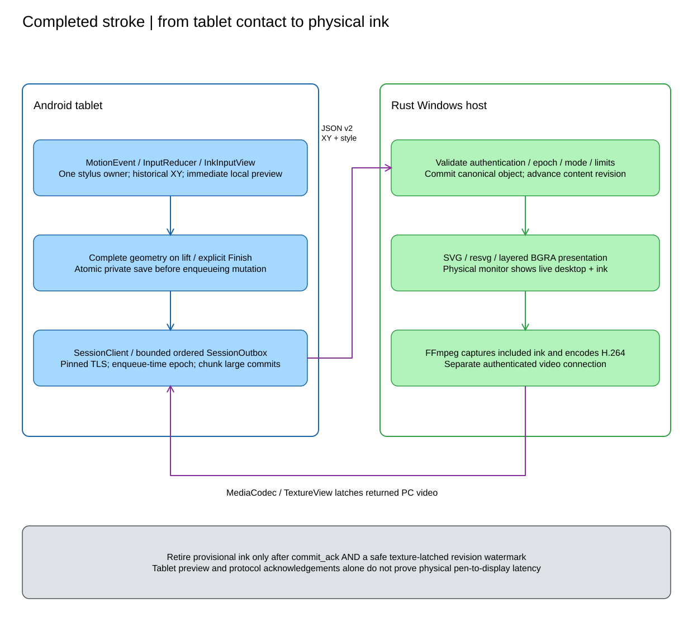
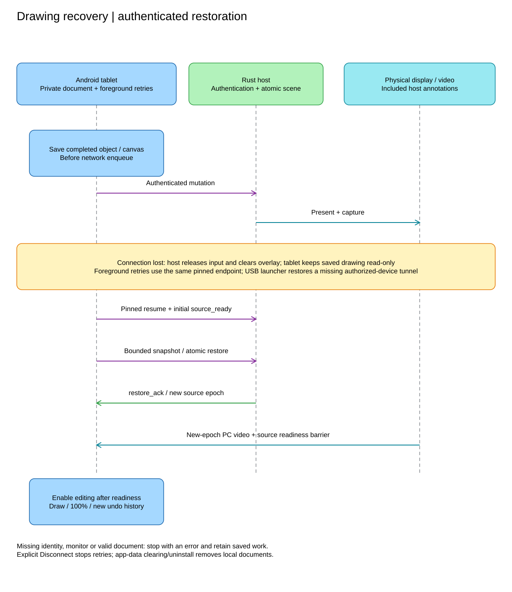

# DrawDock - Android Stylus and Session Specification

Document ID: DD-ANDROID-001 | Version: 0.3 | Updated: 2026-11-06
Baseline: `v0.1.2` Kotlin client; Android 11/API 30 minimum.

## 1. Purpose and ownership

Android receives tablet stylus events, mirrors an existing selected PC monitor
and sends annotation/pointer commands to the Rust host. This is an ordinary app,
not a kernel stylus driver, accessibility service or privileged shell server.
No root or native pressure-aware PC digitizer emulation is implemented.

The host owns live scene validation and physical presentation. Android owns
interaction, provisional feedback, video decode and durable recovery documents.
Tablet-only ink is not successful host annotation. See the
[product contract](DrawDock-prototype-spec-draft.md),
[Rust architecture](DrawDock-rust-overlay-architecture.md) and
[exact protocol](../docs/protocol.md).

## 2. Actual application structure

| Existing Kotlin file | Responsibility |
|---|---|
| `MainActivity` | Native View-based UI, source/mode barriers, gestures, pairing and lifecycle/retries |
| `InkInputView`, `InputReducer` | MotionEvent extraction, active-pointer ownership, ink and pointer gestures |
| `ViewportFit`, `SharedViewport`, `EditorGeometry` | Aspect fit, shared zoom and affine selection/edit mapping |
| `RadialMenuView`, `RadialMenuGeometry` | Pen menu and constrained-screen fallback |
| `SessionClient`, `SessionOutbox` | Pinned TLS, serialization, ordered bounded commands and pacing |
| `PendingInk`, `VideoFrameState`, `VideoGeometry` | Provisional geometry and texture-latched revision/epoch handoff |
| `RemoteVideoDecoder` | Video validation, MediaCodec and worker-based output draining |
| `PairingInvitation`, `RememberedHostStore` | QR/manual invitation and Keystore-protected credentials |
| `ClipboardImage` | Explicit worker-based clipboard PNG decoding/size reduction |
| `DrawingRecovery` | Atomic private per-host/per-monitor snapshots and local mutation/history mirror |

These are files under `android\app\src\main\java\com\drawdock`, not separate
Gradle modules. The app uses Android Views/TextureView, not Compose, generated
protobuf, a JNI transport or a diagnostics-export subsystem.
Compile/target SDK is 36; builds use Java 17.

Permissions are INTERNET and optional QR CAMERA; no tablet MediaProjection,
background input service, broad storage permission or background clipboard
monitor is required. Keep-screen-on is scoped to the active foreground session.

## 3. Input-to-output pipeline

[Editable diagram source](diagrams/input-pipeline.excalidraw).

Input callbacks extract primitives from MotionEvent. Do not retain framework
events or perform socket I/O in callbacks. Historical move samples are processed
oldest first, followed by the current sample for the active pointer ID. Pointer
indices may change; identity is not an array position.

`PenSample` contains pointer/tool identity, View-local XY, monotonic event time
in microseconds, pressure, tilt, orientation and button state. Coordinates must
be finite. Axis values are locally observed metadata; current extraction is
not a complete device motion-range negotiation/diagnostics contract.
Persistent wire objects carry XY and uniform width, not pressure/timestamps.

Only `TOOL_TYPE_STYLUS` owns drawing/pointer contact. Fingers and eraser tool
types do not draw; eraser use is reported as unsupported rather than converted
to ordinary colored ink. One pen owns a gesture; other pointers cannot steal it.
Finger-first input must not prevent later stylus recognition.

## 4. Readiness, contact and cancellation

Contact is admitted only with an active authenticated session, current source
readiness and no pending incompatible mode/source/zoom/edit/recovery operation.
A pen hold while suspended can open tools, but cannot become a drawing or click
when readiness later changes.

Tool, style, pointer button and gesture state are latched at contact start.
Changing mode/source/style, navigation, surface loss or lifecycle state cancels
incomplete geometry before applying new state. Up/cancel must release a pointer
interaction, never reinterpret it as an annotation.

`ACTION_CANCEL` cancels on all supported APIs. On API 33+, canceled up events
use guarded `FLAG_CANCELED` handling. Do not assume perfect palm rejection from
ignoring fingers; verify actual dispatch and hardware cancellation separately.
An unfinished contact is not a durable committed object.

## 5. Drawing, paths and editing

| Tool/action | Implemented behavior |
|---|---|
| Freehand / highlighter | Local sampled preview; complete XY geometry committed on lift; taps make dots |
| Line / arrow / rectangle / ellipse / circle | Two-endpoint/bounding geometry; sub-3-View-pixel drag is canceled |
| Polygon / polyline | Accumulate vertices across taps; explicit Finish path after minimum vertex count |
| Text | Tap anchor, type and Place; no network typing per keystroke |
| Image | Explicit Paste image from tablet clipboard; host validates PNG |
| Select / Move | Host selects topmost transformed object; pen drag previews an oriented frame |
| Rotate / Resize / Mirror | Absolute affine edit preserves original object points and payload |

Commits happen on completion, not as a streamed Begin/Append/CancelPreview
protocol. There is no object eraser/delete command in this baseline.
Tool/style/source/session changes cancel unfinished paths. In Draw mode no
mouse down/up may result from viewport contact.

The menu offers colors including white and three widths. Highlighter is wider
and translucent; text maps width choices to font sizes. Long-press tools use
about 550 ms of stationary pen contact, then lift; movement disarms the hold.
Header Pen tools and a scrollable constrained-layout fallback remain available.

A transform previews selection locally but updates the PC object on pen-up.
Selection is transient single-object UI state. Canvas state, transforms and
objects participate in history. Clear is confirmed; offline Clear explicitly
clears the saved local document rather than contacting the PC.
See [feature behavior](../docs/features.md) for tool-specific details.

## 6. Pointer, laser and navigation

Pointer mode must be host-acknowledged. Hover moves the mouse where hardware
reports it. Ordinary tip contact latches left; primary barrel held at contact
start latches right. Drag sends ordered down/motion/up; short taps click.
Mouse-down is deferred while deciding between short tap, drag and menu hold,
so opening tools does not click the underlying application.

Adjacent compatible motion can coalesce, but never across source epochs,
interaction generations or release barriers. The host independently releases
held buttons on the 1.5-second lease even if Android cannot send termination.

Laser is nonpersistent contact/hover feedback, with 100-ms refresh and about
300-ms host expiry. Stops survive coalescing. Blackboard prohibits Pointer mode.

Two fingers on the ready workspace pinch/pan shared 100-400% magnification.
Single fingers do not draw/click. Navigation waits for actual host viewport
and video readiness, not a speculative local transform. Reset and source/session
changes return to 100%; zoom is not saved drawing metadata.

## 7. Coordinates and source epochs

Video and input use the same aspect-fit rectangle excluding controls/insets.
For source `(Ws,Hs)` and available View `(Wv,Hv)`, fit scale is
`min(Wv/Ws, Hv/Hs)`; center the fitted image and normalize XY within it.
Letterbox starts are ignored; active drags clamp at the edge and still terminate.

Wire geometry is full-monitor normalized XY. Shared viewport maps a visible
point to `origin + visible/scale`; annotation width is divided by scale.
Selection composes viewport with object transform; submitted edits remove the
viewport transform. Physical circle constraints account for source aspect ratio.
Do not use tablet resolution as desktop coordinates or apply rotation twice.

Commands retain their enqueue-time `source_epoch`. A new monitor/zoom/restored
epoch requires a matching texture-latched frame and `source_ready_ack` before
contact resumes. Late callbacks from old session generations cannot mutate
the replacement session.

## 8. Serialization, backpressure and video

Pinned TLS/TCP carries newline-delimited JSON v2 for control, objects and pointer.
A separate video connection authenticates with the same pin and fresh session
video token on the same port, default 47831. USB uses ADB reverse; LAN uses an
explicit host address. No raw UDP, three-port service or certificate bypass.

One ordered writer spaces every frame by at least 12.5 ms (80 frames/s); it does
not burst to catch up. The queue admits 128 ordinary commands and reserves one
additional release slot. Pending stroke accounting is bounded to 8 MiB.
Large final objects use 36-KiB raw chunks within the host's frame/transaction
bounds. Queue/admission failures are explicit, not unbounded buffering.

MediaCodec receives bounded ordered H.264 units and fresh source configuration.
Decoder output drains on its own worker rather than waiting for the next network
packet. Low-latency behavior depends on actual codec support, not API level alone.
Dependent encoded units are not arbitrarily dropped.

Only included-ink video is supported. Local provisional geometry stays until
both correlated commit revision and safe texture-latched watermark arrive,
in either order. Committed objects must not be redrawn over live video.
Preview bounds are separate from durable recovery; disconnect clears uncertain
preview but not saved completed work.

## 9. Durable recovery and lifecycle

[Editable diagram source](diagrams/recovery.excalidraw).

`DrawingRecovery` saves the intended mutation atomically before network enqueue.
Completed object geometry, transforms, text/images and Blackboard/Grid persist
privately by verified host fingerprint and monitor. Local history mirrors the
host's count/estimated-cost policy while connected.

On disconnect, show the saved drawing read-only and retry the same authenticated
endpoint with 1-30-second backoff while foreground. Background/surface loss
ends the connection and retains work; retries resume when the app returns.
Explicit Disconnect/Stop retrying retains work without retries. App restart
loads saved content; the user taps Connect.

After authentication and initial video readiness, chunk and atomically restore
the saved document. Editing stays paused through the new source epoch/video
barrier. Recovery resets undo/redo, laser, selection and zoom, and starts Draw.
Rejected commits are removed; rejected correlated changes are rolled back and
recovery realigns host/local history. Missing monitor, invalid storage,
authentication failure or rejected restoration stops with a visible error.
Automatic retry must never open enrollment or change a certificate pin.

Snapshot limits are 16 MiB per document and 32 MiB aggregate per host, with
ordinary scene limits still enforced. Offline image previews are downsampled
within a bounded bitmap budget without modifying saved PNGs. Synchronous
save-before-send can delay large-scene input. Uninstall/data clearing removes
saved drawings; no export or cloud backup is implemented.

The launcher restores a missing selected-device ADB tunnel after USB cable
reconnect; Android cannot recreate a Windows mapping itself. A CLI host needs
explicit tunnel recreation. Wi-Fi uses the same recovery protocol without ADB.

## 10. Tests, evidence and deferred capabilities

JVM tests live in `android\app\src\test\java\com\drawdock`. Cover pointer ownership,
history ordering, cancellation, letterboxing, affine/zoom transforms, menu
gesture slop, pacing/release slots, video metadata, provisional handoff and
recovery documents. Do not claim a generated protobuf/golden-vector suite exists.

Real device acceptance additionally requires physical pen drawing on the host,
fullscreen visibility, palm/eraser behavior, barrel/hover where supported,
mid-drag loss without stuck buttons, monitor/zoom transitions, real USB/Wi-Fi
interruption and app/host restart recovery. Injected pen events and successful
builds do not prove digitizer latency or hardware behavior.

Pressure-varying ink, motion prediction/front-buffer APIs, native HID emulation,
document export, alternative USB transport and QUIC remain deferred. Future
desktop adapters preserve this normalized scene/wire contract but must advertise
their own actual presentation/input/capture capabilities.

Primary input references:

- [MotionEvent](https://developer.android.com/reference/android/view/MotionEvent).
- [Advanced stylus features](https://developer.android.com/develop/ui/views/touch-and-input/stylus-input/advanced-stylus-features).
- [Input compatibility and cancellation](https://developer.android.com/develop/ui/views/touch-and-input/input-compatibility-on-large-screens).
- [Low-latency MediaCodec](https://source.android.com/docs/core/media/low-latency-media).
