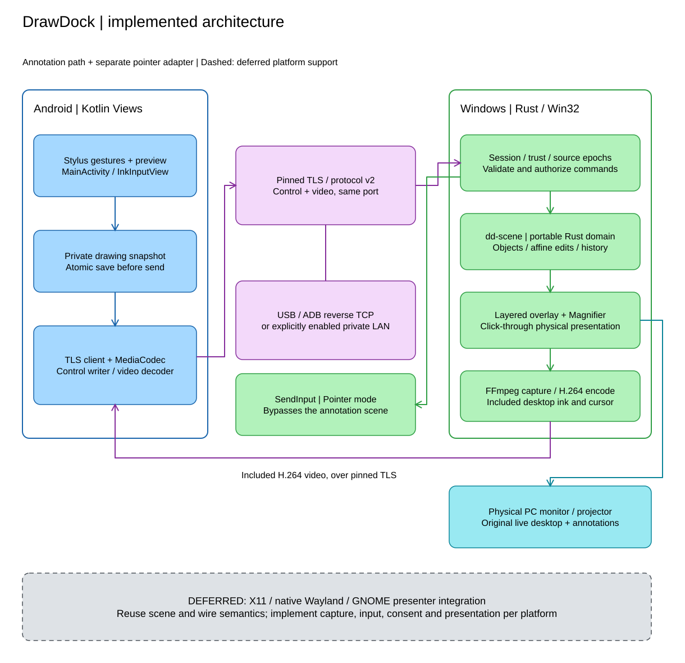
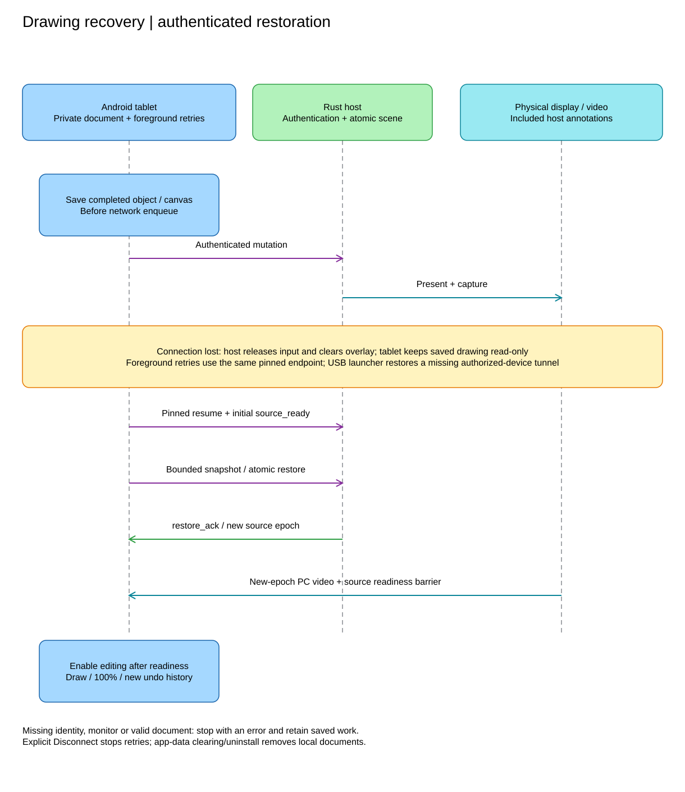

# DrawDock - Product Specification and Release Baseline

Document ID: DD-PRODUCT-001 | Version: 0.3 | Updated: 2026-11-06
Baseline: the `v0.1.2` source tag in the initial `0.1.x` release series.

## 1. Purpose and authority

DrawDock turns an Android pen-enabled tablet into an annotation and pointer
controller for an existing desktop monitor. The selected physical PC display
shows its live applications plus DrawDock annotations; the tablet mirrors that
same composed output. No cloud account or service is required.

This document replaces the original implementation proposal with the current
product contract. It distinguishes **implemented behavior**, **verification
requirements** and **deferred design**. A source tag is not evidence that its
release workflow succeeded or that every device/application combination works.
MUST denotes a required invariant, not a claim of completed hardware validation.

| Specification | Responsibility |
|---|---|
| This document | Scope, requirements, supported baseline and acceptance |
| [Rust architecture](DrawDock-rust-overlay-architecture.md) | Current modules and future platform boundaries |
| [Android input](DrawDock-android-stylus-event-spec.md) | Stylus, gestures, preview, video and recovery |
| [Protocol](../docs/protocol.md) | Exact wire messages, framing, capabilities and limits |
| [Contributor documentation](../docs/README.md) | Installation, builds, operation and troubleshooting |

If a future proposal conflicts with implemented behavior, it must be explicitly
approved and versioned before changing the application or protocol.

## 2. Mandatory product invariant

Annotations MUST appear over the original live selected desktop on the physical
monitor/projector. Tablet-only ink, a frozen screenshot, a DrawDock control-window
canvas or a recursive fullscreen capture are not substitutes.

The overlay MUST preserve normal application focus and click-through behavior.
Draw mode MUST NOT inject mouse clicks into underlying applications. Pointer
mode is separate, explicit and host-acknowledged. Drawing does not modify the
underlying application's files.

Normal composited fullscreen presentations remain an acceptance requirement.
Secure desktop, protected content and exclusive fullscreen paths are limitations,
not permission to bypass Windows protections. Display sharing and application-
window sharing are distinct configurations; the latter may omit external ink.

## 3. Architecture overview

[Editable diagram source](diagrams/architecture.excalidraw).
The dashed future boundary represents design scope, not existing adapters.

## 4. Implemented platform and connection baseline

| Area | Initial release implementation |
|---|---|
| Desktop | Native Rust/Win32 host and launcher; Windows x64 interactive desktop |
| Windows compatibility | Installer accepts Windows 10 or later; actual compatibility must be verified per OS/application/display configuration |
| Tablet | Kotlin Android app; Android 11/API 30 minimum; compile/target SDK 36 |
| USB | Authorized USB debugging and explicit ADB reverse TCP forwarding |
| LAN / Wi-Fi | Tablet connects to an explicitly enabled eligible private/local IPv4 endpoint |
| Security | Pinned TLS and approved device credentials on both connections |
| Session | One active tablet and one selected existing monitor; multiple listeners can share that session |
| Video | SDR H.264, aspect-preserving fit within 2560x1440, requested 30 fps |
| Encoders | Explicit software x264 or compatible NVIDIA NVENC; failure is not silently substituted |

The Windows runtime does not require WSL, Linux, Docker, root or elevation.
The launcher provides monitor/encoder selection, USB discovery, listener controls,
QR pairing, bounded logs and a tray icon. Closing the window hides it; Quit stops
its owned host. Existing CLI hosts and unrelated ADB mappings are not adopted.

Linux X11, native Wayland and GNOME integration are **DEFERRED**. The design
preserves their boundaries, but no Linux executable or compatibility claim is
part of this baseline. macOS, iOS and browser clients are not implemented.

## 5. Requirement traceability

| ID | Current requirement | Verification boundary |
|---|---|---|
| FR-01 | Native Rust desktop application and Kotlin Android client | Build/install plus real end-to-end operation |
| FR-02 | Windows implementation with portable scene semantics | Windows runtime tests; Linux adapters remain deferred |
| FR-03 | USB/ADB and private LAN/Wi-Fi transport | Physical cable loss/reconnect and separate wireless-only runs |
| FR-04 | Bounded, responsive communication | Queue/codec tests and measured latency; QUIC is not a release dependency |
| FR-05 | Select an existing monitor from the tablet | Correct capture, ink and pointer geometry through switching |
| FR-06 | Fit a higher-resolution desktop without distortion | Aspect-fit geometry and text/thin-line quality review |
| FR-07 | Stylus pointer mode | Hover where available, taps, drags, barrel right-click and safe cancellation |
| FR-08 | Host-visible annotation and editing tools | Physical output, fullscreen, pass-through and history tests |
| FR-09 | Preserve completed work through disconnect/restart | Exact object/canvas recovery without duplicates or wrong-monitor restoration |
| SEC-01 | Authenticated encrypted communication and explicit enrollment | Wrong pin/token, rejected approval, replay and revocation tests |
| SAFE-01 | No stuck buttons or stale geometry | Lease expiry, source/mode changes and failure cleanup |

## 6. Drawing and interaction

Implemented tools are freehand, highlighter, line, arrow, rectangle, ellipse,
circle, polygon, polyline, text and clipboard PNG images. Selection supports
move, rotate, resize and horizontal/vertical mirroring. Objects retain original
points and an affine transform; they are not flattened into a screenshot.

Colors include white; thin/medium/thick width choices also select text size.
Undo/redo cover objects, transforms and canvas flags. Clear is one confirmed,
undoable operation removing objects and turning Blackboard/Grid off.

Blackboard fills the selected PC display black; Grid adds 32-physical-pixel
cells. Blackboard forces Draw and prevents concealed pointer clicks. Laser is
transient, has no undo entry and expires without continued refresh.

The radial menu opens after a stationary pen hold of about 550 ms followed by
lift. Header buttons provide a fallback. Fingers operate controls; two fingers
pinch/pan the ready workspace, but neither fingers nor eraser tool types draw.

Shared 100-400% zoom affects the physical monitor and tablet video together.
It is not tablet-only scaling. The local physical PC mouse is not remapped;
reset to 100% before using it to click magnified desktop controls.
See [feature semantics](../docs/features.md).

## 7. Transport and protocol

The implemented control protocol is **version 2**, not protobuf or `drawdock/1`.
Control, drawing and pointer commands share a newline-delimited JSON connection.
A second authenticated connection carries video. Both use the **same listener
port**, default `47831`; there are no separate `47832`/`47833` services.

USB forwards that TCP port with ADB. The launcher checks the selected authorized
USB tablet and restores a missing tunnel after cable reconnect without replacing
conflicting mappings. A command-line host requires explicit tunnel management.
ADB authorization does not replace DrawDock authentication.

Source epochs reject commands queued for old geometry. Input remains suspended
until a frame from the selected epoch is texture-latched and acknowledged with
`source_ready`. Mode/source transitions and the 1.5-second control lease release
held buttons. Large object commits and recovery documents use bounded ordered
transactions, not unreliable preview datagrams.

**Future USB without debugging:** USB networking could reuse TLS/TCP; Android
Open Accessory would require a USB adapter and channel scheduling. Neither is
implemented. Device support, Windows driver deployment, network behavior and
corporate policy must be evaluated first. All-USB-data restrictions are respected,
not bypassed. QUIC/UDP remains a deferred measured experiment.

## 8. Video, geometry and presentation

Windows capture currently uses a Rust-owned FFmpeg `gdigrab` process, not DXGI
Desktop Duplication or Windows.Graphics.Capture. Lanczos scaling and limited-range
BT.709 are explicit. H.264 High/level 5.0 uses no B-frames and a bounded ordered
handoff; Android decodes with MediaCodec into a TextureView.

Capture includes committed PC ink. Android keeps only provisional ink over live
video, retiring it after both object acknowledgement and a safe texture-latched
revision watermark. Conservative attribution can briefly overlap translucent
preview and video; no zero-overlap or input-to-photon guarantee is implied.

Wire geometry uses finite normalized coordinates in the full selected monitor.
Aspect-fit letterboxing is not a drawing target. Windows physical output bounds
can have negative origins. Affine edits and shared zoom preserve canonical
points; source epochs prevent reinterpretation under a changed viewport.
See [video implementation](../docs/video-streaming.md).

## 9. Durable drawing recovery

[Editable diagram source](diagrams/recovery.excalidraw).

Before transmission, Android atomically saves completed objects, transforms,
text/PNG data and Blackboard/Grid in private app storage. Documents are scoped
by host certificate fingerprint and monitor, not IP address or transport.
The current Windows monitor key is its source device name, not a hardware serial
identity; future adapters need their own validated source-mapping contract.

On loss, the PC clears its overlay and releases input. The tablet keeps a
read-only saved drawing, retrying the same authenticated endpoint while
foreground with 1-30-second backoff. Restoration is atomic; editing resumes only
after matching restored PC video. Backgrounding pauses retries until resume.
Explicit Disconnect/Stop retrying retains work and stops retries. After app
restart, tap Connect; the host must also be running.

Wrong identity, absent credentials, a missing saved monitor, corrupt storage or
rejected restoration must produce an error rather than silently replacing data,
enrolling trust or drawing on another output. Recovery starts in Draw at 100%
with new undo/redo history. Laser, selection and unfinished contacts are not
saved. No export/backup exists; Android uninstall/app-data clearing removes
saved documents.

## 10. Bounds and safety

| Resource | Implemented bound |
|---|---|
| Control frame | 64 KiB including newline |
| One object commit | 512 KiB; 3-second transaction lifetime |
| Transaction chunk | 48 KiB decoded host maximum; Android sends 36 KiB |
| Scene | 2,000 objects; 20,000 points/object; 200,000 points total; 8 MiB estimated cost |
| Undo and redo | Each stack: 32 snapshots and 8 MiB estimated cost |
| Recovery | 16 MiB per serialized document; 120-second transaction; 32 MiB aggregate per host on tablet |
| Encoded video unit | 8 MiB; one pending ordered unit |
| Android writer | 80 frames/s; bounded command queue with a reserved release slot |

Estimated scene/history cost is not total process RSS or decoded-image memory.
Reject invalid/oversized payloads before authoritative mutation. Do not discard
dependent encoded H.264 frames and pretend playback remains valid.

The host stores identity/credentials with current-user DPAPI; Android protects
remembered credentials using Keystore-backed storage. Enrollment requires a
single-use expiring invitation and local PC approval. No automatic firewall,
driver, elevation, public listener, network ADB or cloud discovery changes.
See [threat model](../docs/pairing-and-threat-model.md).

## 11. Verification and release acceptance

Report **PASS**, **PARTIAL**, **BLOCKED** or **NOT RUN** with reproducible evidence;
report unimplemented platforms/transports as **DEFERRED**. Compilation, injected
stylus events and screenshots do not prove physical-pen behavior, palm rejection,
fullscreen compatibility or latency.

Required runtime checks include live and fullscreen host-visible tools; focus
and mouse pass-through; pointer release on loss; monitor/zoom geometry barriers;
real USB and Wi-Fi interruption; app/host restart recovery; explicit Disconnect;
wrong identity/permission rejection; and a bounded-memory mixed-use soak.
Future Linux acceptance requires native-session capture, input and overlay
checks separately, including compositor-specific fullscreen evidence.

Requested frame rate and queue deadlines are configuration, not achieved
latency/fps claims. Measure pen-to-local-ink, pen-to-PC-visible and PC-to-tablet
latency separately with appropriate camera evidence. Do not subtract unrelated
Android/PC monotonic clocks or count tablet preview as remote latency.

## 12. Distribution and deferred work

Initial releases provide a per-user Windows installer, portable Windows ZIP,
signed Android APK, bundled runtime notices/source and checksums. Windows EXEs
are not Authenticode-signed; do not bypass OS warnings. GitHub release builds
run on validated version tags, not every commit. See [release contract](../docs/releasing.md).

Deferred work includes Linux X11/Wayland/GNOME adapters, alternative USB
connections, QUIC evaluation, other hardware encoders/native capture pipelines,
document export and multi-client collaboration. These are directions, not
installed dependencies or promises for the current release.
