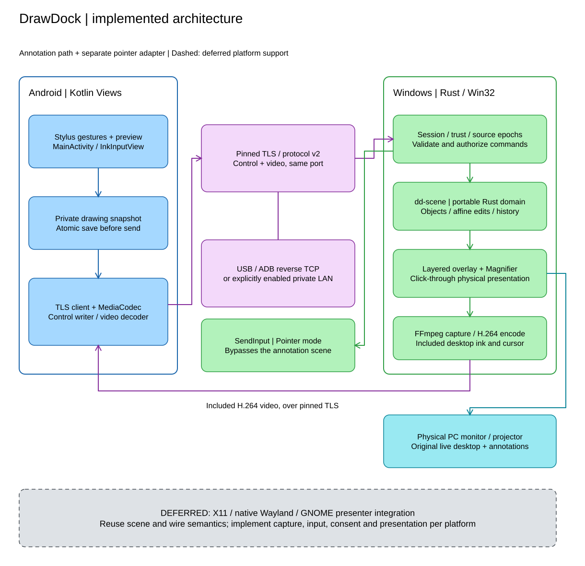

# DrawDock - Rust Cross-Platform Architecture

Document ID: DD-ARCH-001 | Version: 0.3 | Updated: 2026-11-06
Baseline: `v0.1.2` source; Windows implemented, Linux adapters deferred.

## 1. Architectural contract

[Product requirements](DrawDock-prototype-spec-draft.md) define the physical
host-visible annotation invariant. [Android input](DrawDock-android-stylus-event-spec.md)
defines tablet interactions. [Protocol v2](../docs/protocol.md) is authoritative
for wire details; illustrative future APIs must not be treated as implemented.

Desktop application logic is Rust; the tablet client is Kotlin. Native OS APIs,
fonts, codecs and audited libraries are permitted. The scene model remains
platform-independent. Platform integration must not weaken host visibility,
authentication, correct geometry, pass-through or safe input release.

The current Windows host has a Windows-only compile guard. Cross-platform
**design** means preserving reusable domain semantics and explicit OS boundaries;
it does not mean shipping an untested generic adapter or compiling this host
unchanged on Linux.

## 2. Topology and ownership

[Editable diagram source](diagrams/architecture.excalidraw).

The tablet initiates control and video connections to an explicitly enabled
host endpoint. The host owns the live authoritative scene, source geometry,
presentation and pointer injection. Android owns gestures, provisional feedback,
decoding and a durable recovery document. A recovery snapshot is not permission
to mutate an unauthenticated host.

Capture, presentation and input are independent capabilities. A working video
stream does not prove overlay visibility; a future Wayland capture portal does
not grant arbitrary overlay or pointer access.

## 3. Actual workspace

| Existing location | Responsibility |
|---|---|
| `crates\dd-scene` | Typed objects/canvas, validation, selection, affine edits, revision, history and transient laser |
| `apps\dd-host\src\main.rs` | Native Windows CLI, DPI initialization and composition |
| `apps\dd-host\src\launcher` | Win32 controls/tray, logs, owned host and USB tunnel lifecycle |
| `listener_control.rs`, `host_environment.rs` | Listener coordination, endpoint cancellation and eligible interface discovery |
| `session.rs`, `trust.rs`, `pairing_window.rs` | TLS, consent, remembered trust, protocol dispatch and atomic recovery |
| `source.rs`, `zoom.rs` | Source epoch, presentation attribution and bounded viewport geometry |
| `windows_overlay.rs`, `raster.rs` | Layered windows, generated SVG/resvg rasterization and BGRA presentation |
| `windows_input.rs`, `windows_zoom.rs` | SendInput and monitor-scoped native Magnifier |
| `video.rs` | Owned FFmpeg capture/encoder, framing and bounded ordered handoff |
| `android\app` | Kotlin client and JVM tests; no shared Rust/JNI client transport |

Rows without a directory prefix refer to `apps\dd-host\src`.
There are no `dd-protocol`, `dd-win`, `dd-x11`, `dd-wayland`, `dd-transport`
or generated protobuf crates in this baseline. Do not create them merely to
match the old proposal. Extract modules only when a concrete second adapter
needs shared code. Dependency versions belong to checked-in manifests/lockfiles.

Current implementation uses rustls/serde on the host, Win32 APIs, SVG/resvg
rasterization and external FFmpeg. Networking uses bounded synchronous worker
threads and channels, not a speculative Tokio actor architecture.

## 4. Shared domain and geometry

`InkObject` has a unique `u64` ID, tool, RGBA style, uniform normalized width,
original XY points, optional text/base64 PNG and affine `{a,b,c,d,tx,ty}`.
IDs are not UUIDs; pressure samples and author/session metadata are not part
of object geometry. Supported persistent tools match the product specification.

`Scene` owns objects, Blackboard/Grid, content revision, undo/redo and laser.
Committed mutations are ordered and validated before application. A new edit
after Undo discards Redo. History excludes laser. Clear removes objects and
canvas flags as one undoable operation; session reset also discards history.
Do not assume arbitrary command retransmission is idempotent: uncertain work
is recovered by validated scene replacement, not blind replay.

Coordinates remain finite and normalized in the full selected source. Windows
maps to physical monitor pixels and virtual-desktop bounds, including negative
origins. Object transforms preserve original geometry. Output aspect ratio
matters for circles and rotation.

Shared viewport mapping is `visible = (source - origin) * scale`, with
`scale` in `[1,4]`. Android uses the inverse for new points and pointer targets.
New widths scale inversely; selection uses viewport composed with object affine
geometry. The native presenter acknowledges actual pixel-quantized source bounds.

The source epoch changes when monitor, viewport or restored presentation changes.
Queued coordinates retain their original epoch. Input resumes only after a
texture-latched frame and `source_ready` for the current epoch.

## 5. Windows presentation and input

The selected output has a topmost, layered, click-through, non-activating
annotation window. Typed scene data produces SVG, resvg rasterizes it, and
premultiplied BGRA is submitted with `UpdateLayeredWindow`.
Windows DPI awareness is initialized before enumeration and window creation.

Laser uses a separate small layered window, avoiding whole-scene rasterization
for each sample. Shared zoom uses a monitor-scoped native Magnifier host/child,
excluding itself from its source to prevent recursive composition. Both the
physical display and captured tablet view include the magnified desktop/ink.
No global magnifier setting, UIAccess or automatic elevation is used.

Pointer mode routes normalized coordinates through `SendInput`. Held-button
state and interaction generations reject overlap/stale transitions. Mode/source
changes, history, Clear and teardown release remote buttons. Blackboard forces
Draw, preventing clicks into a concealed desktop. UIPI, secure desktop,
protected content and exclusive fullscreen remain OS restrictions.

Topmost style is not proof of universal fullscreen stacking. Validate the actual
application's composited presentation mode, selected display, focus and click-
through behavior; never replace the live application with an opaque substitute.

## 6. Capture, video and provisional ink

Current capture is FFmpeg `gdigrab` of the selected physical rectangle including
cursor and overlays. Explicit x264/NVENC encoding yields bounded Annex-B access
units and capture metadata. Video authenticates on a second TLS connection to
the same listener; Android renders with MediaCodec/TextureView.

Only **included** annotation capture mode is implemented. Android does not paint
its committed document over live video. Provisional ink remains until a matching
commit acknowledgement and safe texture-latched scene watermark both arrive.
The presenter records completed intervals after native presentation; conservative
capture attribution is not proof of photons or perfect translucent handoff.

A presenter revision, encoder timestamp and Android texture latch are different
events. Preserve their epoch/revision relationship. Bound ordered encoded
handoff rather than dropping referenced frames; a sustained stall ends the
stream and recovery starts from fresh codec configuration/keyframe.
See [video streaming](../docs/video-streaming.md) for exact parameters.

## 7. Session, recovery and concurrency

The presentation loop is separate from session/network work. Shared scene/source
state uses `Arc<Mutex<...>>`; channels coordinate presenter work and owned
processes. Native windows live on their owning thread. Do not mark handles
blanket Send/Sync or block UI loops on network I/O.

The launcher starts one sibling host via bounded stdin/stdout control, not a
new management TCP service. A kill-on-close Job Object owns only its child tree.
Independent explicitly enabled endpoints share trust, overlay and one session.
Disabling the active endpoint tears that session down; disabling another
endpoint does not. Private interface eligibility is rechecked.

While USB is enabled, missing ADB forwarding is restored only for the selected
authorized tablet. Conflicting/preexisting mappings are not silently replaced.
Stop/Quit performs bounded cleanup and reports errors without stopping shared
ADB servers or unrelated host processes.

Disconnect clears host scene/history, laser and zoom, and releases input.
Android's private per-host/per-monitor document retains completed work. A
bounded `begin_restore` / `restore_chunk` / `finish_restore` transaction validates
identity, length, digest and scene before atomic installation. Success forces
Draw, resets history/zoom and advances the source epoch; new video readiness is
required before editing. See the [recovery diagram](diagrams/recovery.svg).

Android saves before sending mutations, removes rejected commits and rolls back
rejected correlated edits. Authentication/storage/monitor errors must be visible
and must not erase the document or silently enroll another identity. Saving is
currently synchronous; large-scene latency is a limitation, not permission to
send work before durable persistence.

## 8. Cross-platform extension boundaries

These are **future responsibilities**, not existing Rust traits or packages.

| Boundary | Contract preserved across platforms |
|---|---|
| Output registry | Authorized source identity, physical/logical dimensions and unambiguous source mapping |
| Presenter | Transparent host-visible ink, pass-through, focus preservation and native lifecycle |
| Capture/encode | Correct selected source, explicit ink inclusion, bounded frames and configuration |
| Input | OS-approved pointer injection, generation/epoch checks and unconditional release on loss |
| Trust/consent | Pinned identity, device approval/revocation and appropriate OS secret storage |
| Transport | Authenticated control/video channels, framing, flow control and safe reconnection |
| Shared domain | Reuse `dd-scene` validation/geometry/history; preserve protocol semantics |

### Linux X11 - deferred

Evaluate RandR topology, ARGB/compositor presentation, empty input shape,
XTEST injection and appropriate capture. Probe required extensions separately.
Fullscreen WM behavior and alpha upload formats require real X11 evidence.
No compositor or missing extensions must produce an unsupported result.

### Native Wayland - deferred

Use permissioned ScreenCast/PipeWire capture and RemoteDesktop/EIS or supported
portal input. Map authorized streams to compositor output/input regions rather
than equating portal IDs with physical outputs. XWayland/XTEST is not native
Wayland support; root, `/dev/uinput` and unrestricted evdev are not defaults.

Layer-shell is a possible presenter only where the compositor advertises it.
Respect configure/ack, empty input regions, buffer release, scaling and output
transforms. Portal capture alone does not supply a global annotation surface.

### GNOME Wayland - deferred, separate approval

If required, evaluate a minimal version-pinned GNOME Shell/GJS presenter bridge.
This is an explicit exception to all-Rust desktop application logic, not an
already approved or installed extension. Rust retains authentication/domain
state; the extension must not add network listeners, arbitrary script execution
or input injection. Bound local IPC, verify peer ownership and clean up every
actor/subscription on disable, backend loss and shell restart.

### Alternative transport/capture - deferred

USB networking can retain TLS/TCP. AOA requires actual USB discovery/bulk/channel
integration and deployable Windows driver access; encryption/trust stay intact.
QUIC and native DXGI/WGC capture are candidates to benchmark, not dependencies
to add preemptively. No adapter may silently degrade to tablet-only annotation.

## 9. Verification and references

Reuse shared scene tests; add platform-specific tests at the boundary actually
introduced. Existing Rust tests live in each crate's `tests\unit` and remain
private child modules. Test protocol rejection, resource bounds, source barriers,
recovery atomicity and ordered video separately from physical runtime acceptance.

Each supported OS/session needs real live/fullscreen overlay, pass-through,
geometry, pointer-release, transport-loss and soak evidence. Missing Linux
adapters are DEFERRED, not failed Windows release prerequisites. Document
performance configuration separately from measured latency.

Primary platform references, not DrawDock compatibility guarantees:

- [Win32 window features](https://learn.microsoft.com/en-us/windows/win32/winmsg/window-features)
  and [SendInput](https://learn.microsoft.com/en-us/windows/win32/api/winuser/nf-winuser-sendinput).
- [Wayland layer-shell](https://wayland.app/protocols/wlr-layer-shell-unstable-v1).
- [XDG ScreenCast](https://flatpak.github.io/xdg-desktop-portal/docs/doc-org.freedesktop.portal.ScreenCast.html)
  and [RemoteDesktop](https://flatpak.github.io/xdg-desktop-portal/docs/doc-org.freedesktop.portal.RemoteDesktop.html).
- [GNOME extension architecture](https://gjs.guide/extensions/overview/architecture.html).
